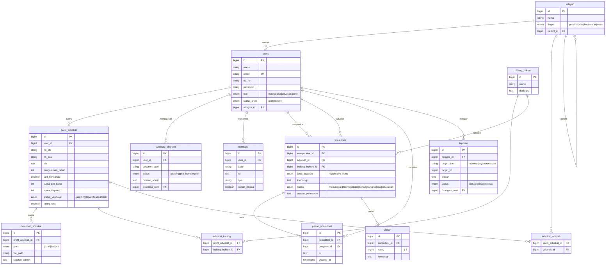
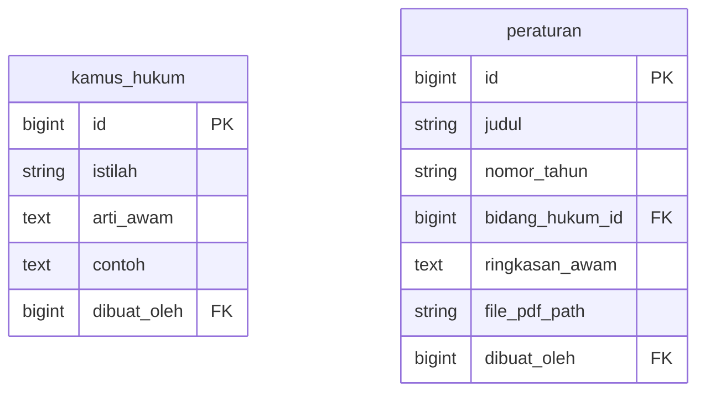

# erd.md — ERD Konsulaw

> Sumber: Proposal Kelompok A (Bab 4.3, 13 tabel). Nama tabel sesuai proposal. **Kolom = usulan**, sesuaikan dengan gambar ERD final.

## Diagram (Mermaid)

## Penjelasan per modul

### Modul Akun
- **users**: tabel utama semua pengguna. Pembeda peran lewat kolom `role`.
- **verifikasi_ekonomi**: dokumen + hasil pemeriksaan status ekonomi (pending / pro_bono / reguler) untuk akses pro bono.
- **notifikasi**: pemberitahuan dalam aplikasi (status konsultasi, hasil verifikasi).
- **wilayah**: referensi wilayah, dipakai buat domisili user dan wilayah praktik advokat.

### Modul Advokat
- **profil_advokat**: data khusus advokat (KTA, BAS, pengalaman, tarif, kuota pro bono).
- **dokumen_advokat**: berkas verifikasi (ijazah, BAS, KTA) yang diperiksa admin.
- **bidang_hukum**: referensi bidang keahlian.
- **advokat_bidang** dan **advokat_wilayah**: tabel pivot many-to-many. Satu advokat bisa banyak bidang dan banyak wilayah.

### Modul Konsultasi
- **konsultasi**: pengajuan masyarakat ke advokat (bidang, jenis layanan, kronologi, status).
- **pesan_konsultasi**: isi chat selama konsultasi.
- **ulasan**: rating 1-5 + komentar, **maksimal satu per konsultasi**.
- **laporan**: pengaduan terhadap profil, layanan, atau ulasan untuk ditindak admin.

## Relasi utama
| Relasi | Kardinalitas |
|---|---|
| users — profil_advokat | 1 : 0..1 (hanya role advokat) |
| profil_advokat — dokumen_advokat | 1 : N |
| profil_advokat — bidang_hukum | N : M (via advokat_bidang) |
| profil_advokat — wilayah | N : M (via advokat_wilayah) |
| users — verifikasi_ekonomi | 1 : N |
| users (masyarakat) — konsultasi | 1 : N |
| users (advokat) — konsultasi | 1 : N |
| konsultasi — pesan_konsultasi | 1 : N |
| konsultasi — ulasan | 1 : 0..1 |

## Aturan integritas (usulan)
- `ulasan.konsultasi_id` UNIQUE, dan hanya boleh dibuat kalau `konsultasi.status = selesai`.
- `profil_advokat.kuota_terpakai <= kuota_pro_bono`.
- `konsultasi.jenis_layanan = pro_bono` hanya boleh kalau `verifikasi_ekonomi.status = pro_bono`.
- Pivot `advokat_bidang` dan `advokat_wilayah` pakai composite unique.

## Tabel tambahan usulan (DI LUAR 13 tabel proposal)
Dibutuhkan fitur edukasi (LAW-16, LAW-17). Kalau mau tetap 13 tabel, ini harus diputuskan dulu sama tim.

