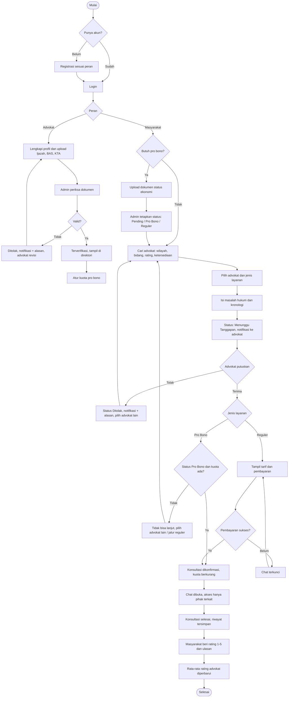
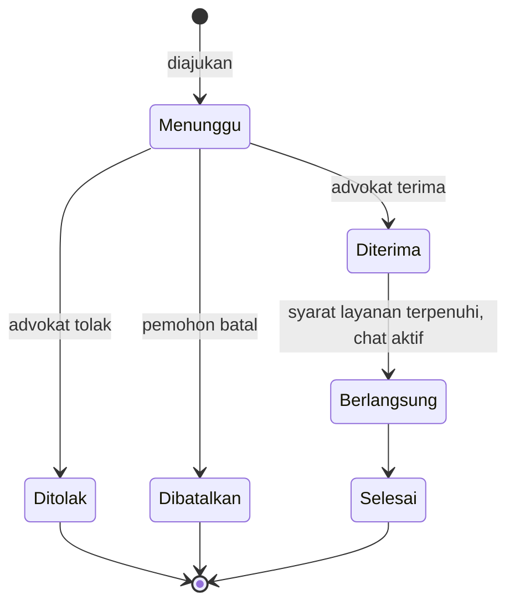

# flow_bisnis.md — Alur Bisnis Konsulaw

> Sumber: Proposal Bab 2.3 (As-Is dan To-Be) dan use case Bab 4.1.

## 1. As-Is (kondisi sekarang)
1. Masyarakat cari advokat lewat medsos, rekomendasi, atau iklan lepas.
2. Hubungi advokat manual untuk tanya layanan, kualifikasi, dan biaya.
3. Konsultasi biasanya harus datang langsung ke kantor advokat / LBH.
4. Cari info bantuan gratis dan syarat kelayakannya secara terpisah.
5. Cari sendiri istilah hukum dan peraturan terkait.

**Masalah:** info tersebar, kualifikasi advokat nggak bisa dicek, kendala jarak dan biaya, pro bono belum terintegrasi dengan pencarian advokat, rawan advokat bodong dan calo.

## 2. To-Be (alur Konsulaw)

## 3. Alur per aktor

### Pengunjung (belum login)
- Lihat direktori advokat, Kamus Hukum Populer, dan Daftar Peraturan.
- Registrasi atau login.

### Masyarakat
1. Registrasi dan login, kelola profil.
2. (Opsional) ajukan verifikasi status ekonomi untuk pro bono.
3. Cari dan filter advokat, lihat detail profil.
4. Ajukan konsultasi (pilih layanan, isi kronologi).
5. Terima notifikasi hasil, chat dengan advokat.
6. Beri rating dan ulasan, laporkan jika ada masalah.

### Advokat
1. Registrasi, lengkapi profil, upload dokumen verifikasi.
2. Tunggu verifikasi admin, lalu atur bidang, wilayah, tarif, kuota pro bono.
3. Tinjau permintaan masuk, terima atau tolak (wajib alasan kalau tolak).
4. Chat dengan masyarakat, tandai konsultasi selesai.

### Admin
1. Verifikasi dokumen advokat (setujui / tolak + alasan).
2. Verifikasi dokumen ekonomi masyarakat (tetapkan status).
3. Kelola konten edukasi (kamus dan peraturan).
4. Kelola akun (nonaktifkan) dan tindak lanjut laporan.

## 4. Status konsultasi

## 5. Aturan bisnis penting
- Advokat **baru tampil di direktori** setelah status *Terverifikasi*.
- Pro bono hanya kalau status ekonomi = **Pro Bono** dan **kuota bulanan** advokat masih ada.
- Kuota berkurang saat konsultasi pro bono **dikonfirmasi**, dan **dikembalikan** kalau pengajuan ditolak.
- Chat hanya bisa dibuka setelah syarat layanan terpenuhi, dan hanya diakses 2 pihak terkait.
- Rating 1-5, **satu per konsultasi**, hanya setelah status *Selesai*.
- Keputusan manusia tetap manual: verifikasi dokumen, terima/tolak kasus, penanganan sengketa.

## 6. Batasan sistem
- Bukan pengganti advokat dan tidak menjamin hasil perkara.
- Tidak mencakup persidangan atau pengajuan dokumen ke pengadilan.
- Status verifikasi bukan pengesahan resmi pemerintah / organisasi advokat.
- Ketersediaan pro bono bergantung pada advokat.

## 7. Catatan: pembayaran reguler (perlu diputuskan tim)
Proposal tidak konsisten. Bab proses bisnis dan FR-10 bilang sistem memverifikasi pembayaran, tapi Bab jadwal bilang pembayaran **di luar sistem** (tanpa payment gateway).
- **Opsi A (sesuai jadwal):** sistem hanya tampilkan tarif dan advokat konfirmasi manual bahwa pembayaran sudah diterima.
- **Opsi B:** integrasi payment gateway, tapi wajib tambah FR, TR, PBI, dan tabel pembayaran dulu.